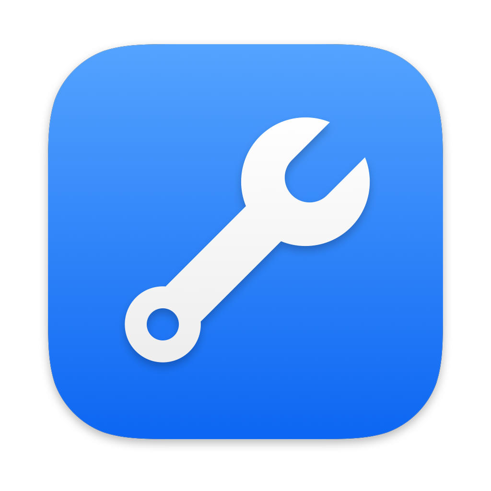

# Mac Tweaks

Нативное приложение для macOS (SwiftUI + AppKit), которое собирает базовые настройки системы в одном месте:
чтобы быстро настроить новый Mac или чужой. Систему меняет только по явной кнопке.



## Что умеет

| Раздел | Что делает |
|---|---|
| Строка меню | Отступы между значками (`NSStatusItemSpacing`, `NSStatusItemSelectionPadding`). На macOS 27.2 системные значки ControlCenter эти ключи не учитывают |
| Dock | Обычные и узкие пробелы между значками слева и справа, резервная копия и восстановление |
| Клавиатура | Смена раскладки по Command+Shift |
| Мышь | Обращение колеса мыши отдельно от тачпада, прокрутка по строкам без ускорения; указатель без ускорения или с разгоном «как в Windows» |
| Не засыпать | Mac не засыпает 15 мин – 8 ч или без срока, по желанию не гаснет экран; управляется из значка-ключа в строке меню |
| Настройки | Значок в строке меню и в Dock, запуск при входе в систему |

## Сборка

Нужны macOS 14+ и Swift (Xcode или Command Line Tools). Xcode-проекта нет, это Swift Package.

```bash
./scripts/make-signing-cert.sh   # один раз: локальный сертификат подписи, чтобы разрешения не слетали после пересборки
./build.sh                       # dist/MacTweaks.app
./build.sh --install             # + копирует в ~/Applications и запускает
swift test
```

Клавиатуре и мыши нужны «Универсальный доступ» и «Мониторинг ввода»
(Системные настройки → Конфиденциальность и безопасность).

## Документы

- [docs/ROADMAP.md](docs/ROADMAP.md) — статусы функций и идеи.
- [docs/JOURNAL.md](docs/JOURNAL.md) — журнал разработки: что пробовали, что сработало и что нет на разных версиях macOS.
- [CLAUDE.md](CLAUDE.md) — устройство кода и порядок работы.

## Лицензия

[MIT](LICENSE).
